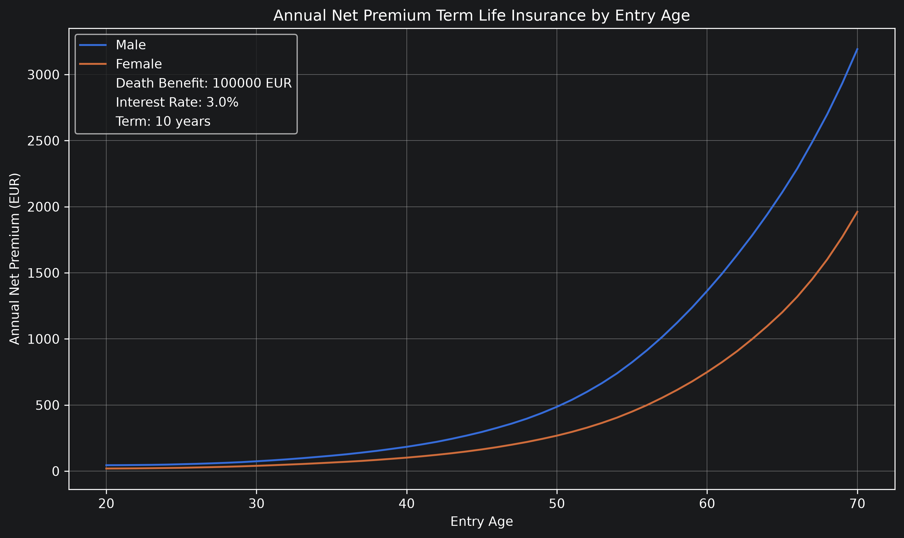

# Life Insurance Simulation Framework

A Python-based framework for actuarial calculations and simulations in life insurance.

## Overview

This project implements a modular framework for modelling mortality and life insurance contracts.

The primary objective is to apply actuarial mathematics using Python while following principles of object-oriented programming.

The framework currently focuses on term life insurance and can be extended to other life insurance products.

## Features

- Mortality modelling based on empirical mortality tables
- Calculation of annual death and survival probabilities
- Simulation of individual lifetimes using Monte Carlo methods
- Expected present value of insurance benefits
- Calculation of net premiums using the equivalence principle
- Data preprocessing and validation

## Actuarial Concepts

The current implementation covers:

- Annual mortality probabilities (qx)
- Annual survival probabilities (px)
- Deferred death probabilities
- Discounting and present value calculations
- Temporary life annuities-due
- Net single and annual premiums
- Equivalence principle

## Data

The mortality model uses mortality data obtained from the German Federal Statistical Office (Destatis).

The original data is transformed into a standardized mortality table containing age- and gender-specific mortality probabilities.

## Technologies

- Python
- NumPy
- Pandas
- Matplotlib
- Jupyter Notebook

## Project Structure

The project separates the actuarial calculation logic and the data preprocessing into independent components.

## Limitations and Assumptions

The current framework is a simplified actuarial model intended for my own educational and demonstration purposes.

The implementation assumes:

- Annual mortality probabilities
- A constant technical interest rate
- Annual premium payments in advance
- Death benefits paid at the end of the year of death
- No expenses, commissions, taxes or surrender benefits
- No lapse or policyholder behaviour modelling

The mortality assumptions are based on the selected population mortality table and do not necessarily represent insured-life mortality.

## Analysis
The notebook 01_term_life_pricing.ipynb demonstrates how annual net premiums vary with the entry age of the insured person.

It compares male and female policyholders using gender-specific mortality assumptions.

The analysis uses the equivalence principle to calculate annual net premiums for a 10-year term life insurance contract.

## Future Development

Planned extensions include:

- Whole life insurance
- Endowment insurance
- Annuity products
- Gross premium calculations
- Technical provisions and prospective reserves
- Monte Carlo portfolio simulations
- Sensitivity and scenario analysis